```{r setup, include=FALSE}
knitr::opts_chunk$set(echo = TRUE,comment="")
```


```{r}
#| include: false
# 指定图形的中文字体
par(family  = 'STKaiti')
#install.packages("showtext")
library(showtext)
showtext_auto()
```


# 10.1 方差分析引论

---

## 男生和女生薪酬比较

两个总体均值的t检验

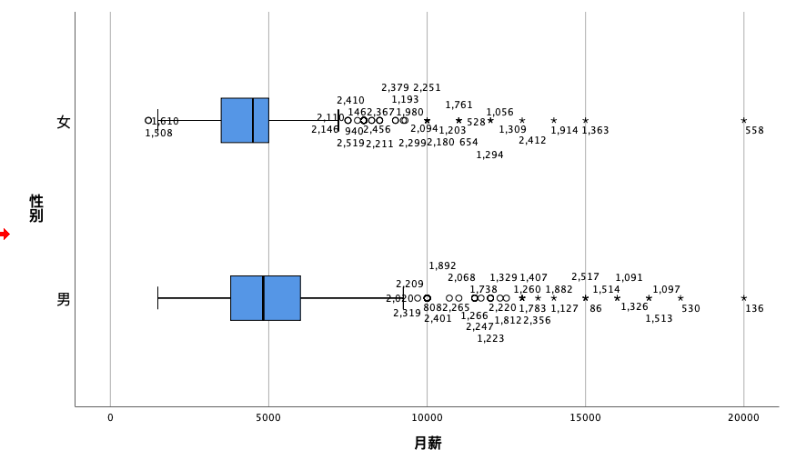{width=55% fig-align="center"}

---


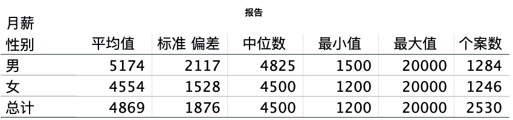{width=65% fig-align="center"}

---

### 两个总体均值的比较：独立样本 $t$ 检验

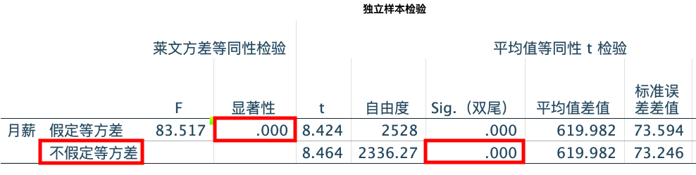{width=85% fig-align="center"}

::: {.callout-tip}
### 回顾
比较**两个**总体均值是否相等时，可以使用第 8 章（8.3.2 节）的**两独立样本 $t$ 检验**。
:::

---

## 拓展问题：五个学院薪酬分布的箱线图

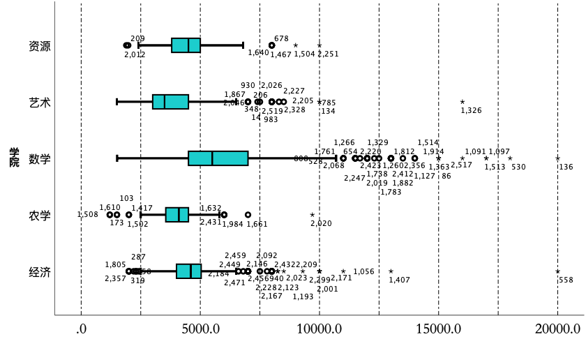{width=75% fig-align="center"}

---

### 五个学院毕业生薪酬差异比较

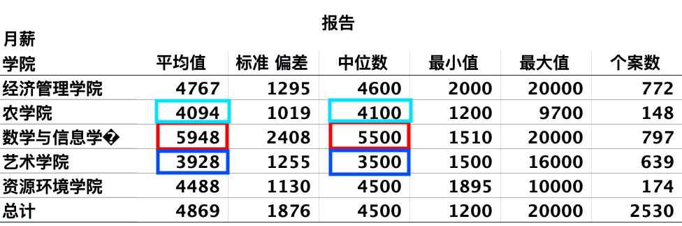{width=85% fig-align="center"}

---

### 五个学院的毕业生薪酬是否存在显著差异？

如果对五个学院进行**两两比较**，需要进行 $C_5^2 = 10$ 次检验：

::: {.columns}
::: {.column width="50%"}
- 经管 VS. 资环
- 经管 VS. 数信
- 经管 VS. 农学
- 经管 VS. 艺术
- 资环 VS. 数信
:::
::: {.column width="50%"}
- 资环 VS. 农学
- 资环 VS. 艺术
- 数信 VS. 农学
- 数信 VS. 艺术
- 农学 VS. 艺术
:::
:::

---

### 两个总体均值是否相等的 $t$ 检验：10 次

$$
\begin{aligned}
H_0: \mu_1 = \mu_2 \quad &\text{vs.} \quad H_1: \mu_1 \neq \mu_2 \\
H_0: \mu_1 = \mu_3 \quad &\text{vs.} \quad H_1: \mu_1 \neq \mu_3 \\
\vdots \quad &\qquad \qquad \vdots \\
H_0: \mu_4 = \mu_5 \quad &\text{vs.} \quad H_1: \mu_4 \neq \mu_5
\end{aligned}
$$

---

### 示例：不同学院的毕业生薪酬是否存在显著差异？

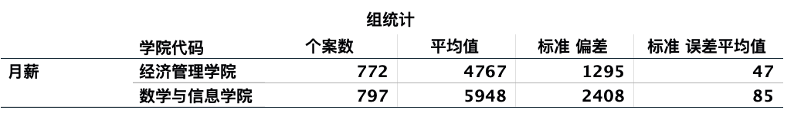{width=80% fig-align="center"}

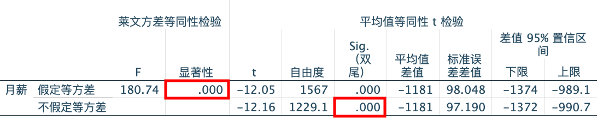{width=85% fig-align="center"}

---

### 示例：农学院与艺术学院毕业生平均薪酬是否存在显著差异？

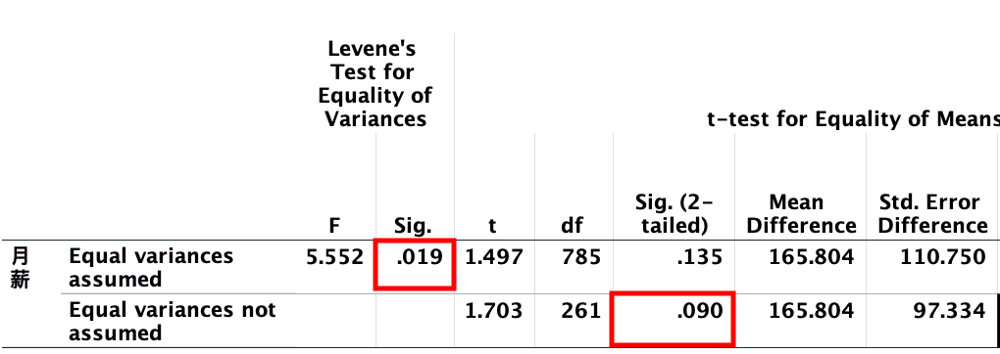{width=75% fig-align="center"}

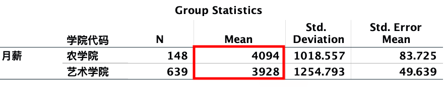{width=80% fig-align="center"}

---

### 为什么不能直接做 10 次 $t$ 检验？

使用两个总体均值的假设检验（8.3.2 节的方法）做 10 次检验存在明显缺陷：

- 每一次假设检验**只利用两组样本的信息**。

---

- 若将每次假设检验的显著性水平定为 $\alpha = 0.05$：
  - 每次检验中犯第一类错误的概率上限为 $0.05$，不犯第一类错误的概率下限为 $0.95$。
  - 在 10 次独立检验中，每次都不犯第一类错误的联合概率为：
    $$0.95^{10} = 0.599$$
  - 至少有 1 次犯第一类错误的概率上升为：
    $$1 - 0.599 = 0.401$$

---    

::: {.callout-warning}
### 结论
做 10 次假设检验不仅**繁琐、耗时**，而且**犯第一类错误的风险大大增加**！
:::


## 多个总体均值的比较：方差分析

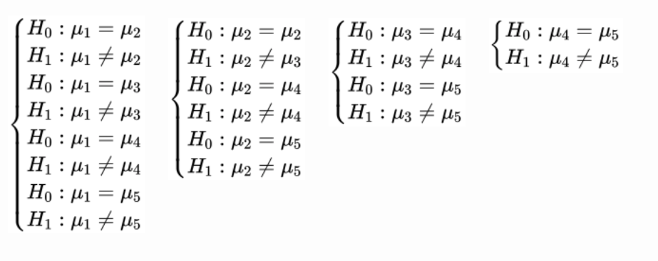{width=75% fig-align="center"}

- **方差分析**与做 10 次两两假设检验**不等价**。
- 做 10 次假设检验会使犯第一类错误的风险大幅膨胀。

---

### 方差分析：Analysis of Variance (ANOVA)

- **核心目的**：讨论**多个总体均值**的相等性。
- **核心优势**：
  - **同时比较**多个总体均值是否相等。
  - 避免了做多次两两假设检验导致**犯第一类错误概率增加**的风险。

---

## 统计学家：Ronald Fisher

::: {.columns}
::: {.column width="35%"}
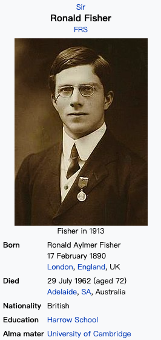{width=80% fig-align="center"}
:::
::: {.column width="65%" style="font-size: 75%; line-height: 1.4;"}
**Ronald Fisher (1890–1962)**

- British statistician and geneticist.
- From 1919 onward, he worked at the **Rothamsted Experimental Station** for 14 years; there, he analysed its immense data from crop experiments since the 1840s, and developed the **analysis of variance (ANOVA)**.
- In 1921, published *Studies in Crop Variation*, marking his first application of the analysis of variance (ANOVA).
- 参考：[Wikipedia — Ronald Fisher](https://en.wikipedia.org/wiki/Ronald_Fisher)
:::
:::

---

### Fisher 的贡献：开创了现代统计学

**主要学术贡献**：

- $F$ 分布
- 实验设计（Experimental Design）
- Fisher 判别分析
- 极大似然估计

---

::: {.callout-note}
### 学界评价
- “A genius who almost single-handedly created the foundations for modern statistical science.” — Hald, Anders (1998), *A History of Mathematical Statistics*, New York: Wiley.
- “The single most important figure in 20th century statistics.” — Efron, Bradley (1998), *R. A. Fisher in the 21st century*, *Statistical Science*, 13(2): 95–122.
:::


## 方差分析的原假设和备择假设

$$
\begin{aligned}
H_0 &: \mu_1 = \mu_2 = \cdots = \mu_k \\
H_1 &: \mu_1, \mu_2, \cdots, \mu_k \text{ 不全相等}
\end{aligned}
$$

- **原假设 $H_0$**：不同组别（因子水平）下，定量变量的总体均值相等。
- **备择假设 $H_1$**：不同组别（因子水平）下，定量变量的总体均值不全相等（即至少有两个总体的均值不相等。

---

::: {.callout-warning}
### 常见误区
$H_1$ **不能**表达成：$\mu_1 \neq \mu_2 \neq \cdots \neq \mu_k$！
“不全相等”是指**即至少有两个总体的均值不相等**，而非所有总体均值两两都不相等。
:::

---

## 方差分析中的术语

- **因素 / 因子（Factor）**：定性变量
- **水平（Level）/ 处理（Treatment）**：定性变量的具体取值
- 定量变量

---

## 方差分析的假定

1. **正态性**：各个总体服从正态分布
2. **方差齐性**：各个总体的方差相同
3. **独立性**：观测值是相互独立的

---

::: {.callout-note}
### 实践注意
- 对于**大样本**，即使总体不严格满足“正态分布”和“方差齐性”，ANOVA 的检验结论仍然**稳健**。
- 对于**小样本**，如果总体非正态且方差不齐，应改用非参数检验方法，如 **Kruskal–Wallis 检验**等。
:::


# 10.2 单因素方差分析

---

## 方差分析思想：总平方和的分解

$$SST = SSA + SSE$$

- **$SST$（Sum of Squares Total，总平方和）**：全部观测值的总变异。
- **$SSA$（Sum of Squares due to Treatment，组间平方和）**：因子效应，反映**系统误差**（因子水平差异造成）和**随机误差**。
- **$SSE$（Sum of Squares due to Error，组内平方和）**：残差效应，仅反映**随机误差**。

---

### 总平方和 $SST$（Total Sum of Squares）

$$SST = \sum_{i=1}^{k} \sum_{j=1}^{n_i} (x_{ij} -\bar{\bar{x}})^2$$


- **$SST$**：反映了所有观测值围绕**总均值**的变异。
- **$x_{ij}$**：第 $i$ 个因子水平下的第 $j$ 个观测值。
- **$\bar{\bar{x}}$**：总均值（the overall mean）。

---

### 组间平方和 $SSA$

$$SSA = \sum_{i=1}^{k} n_i (\bar{x}_i - \bar{\bar{x}})^2$$

- **$\bar{x}_i$**：第 $i$ 组的组内均值（treatment mean）。
- **$SSA$**：反映了各**组内均值**围绕**总均值**的变异。
- **$SSA$ 的统计含义**：因子效应，反映了**系统误差**（由因子水平差异造成）$+$ **随机误差**的总和。

---

### 组内平方和 $SSE$

$$SSE = \sum_{i=1}^{k} \sum_{j=1}^{n_i} (x_{ij} - \bar{x}_i)^2$$

- **$\bar{x}_i$**：第 $i$ 组的组内均值（treatment mean）。
- **$SSE$**：反映了各观测值围绕其所在**组内均值**的变异。
- **$SSE$ 的统计含义**：残差效应，仅反映了**随机误差**。

---

### 总平方和的分解示意图

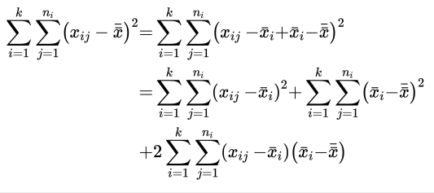{width=70% fig-align="center"}

---

### 数学推导：总平方和 $=$ 组内平方和 $+$ 组间平方和

::: {style="font-size: 72%;"}

$$
\begin{aligned}
SST &= \sum_{i=1}^{k}\sum_{j=1}^{n_i}(x_{ij} - \bar{\bar{x}})^2 \\
    &= \sum_{i=1}^{k}\sum_{j=1}^{n_i}\big[(x_{ij} - \bar{x}_i) + (\bar{x}_i - \bar{\bar{x}})\big]^2 \\
    &= \underbrace{\sum_{i=1}^{k}\sum_{j=1}^{n_i}(x_{ij} - \bar{x}_i)^2}_{\text{组内平方和 } SSE}
     + \underbrace{\sum_{i=1}^{k} n_i (\bar{x}_i - \bar{\bar{x}})^2}_{\text{组间平方和 } SSA}
     + 2\sum_{i=1}^{k}\sum_{j=1}^{n_i}(x_{ij} - \bar{x}_i)(\bar{x}_i - \bar{\bar{x}})
\end{aligned}
$$
::: 

---

### 证明：交叉项等于 0

::: {style="font-size: 55%;"}
$$
\begin{aligned}
\sum_{i=1}^{k} \sum_{j=1}^{n_i} (x_{ij} - \bar{x}_i)(\bar{x}_i - \overline{\overline{x}})
&= \sum_{i=1}^{k} \sum_{j=1}^{n_i} (x_{ij} - \bar{x}_i)\bar{x}_i
 - \sum_{i=1}^{k} \sum_{j=1}^{n_i} (x_{ij} - \bar{x}_i)\overline{\overline{x}} \\
&= \sum_{i=1}^{k} \bar{x}_i \sum_{j=1}^{n_i} (x_{ij} - \bar{x}_i)
 - \overline{\overline{x}} \sum_{i=1}^{k} \sum_{j=1}^{n_i} (x_{ij} - \bar{x}_i) \\
&= \sum_{i=1}^{k} \bar{x}_i
   \underbrace{\left( \sum_{j=1}^{n_i} x_{ij} - \sum_{j=1}^{n_i} \bar{x}_i \right)}_{= \, 0}
 - \overline{\overline{x}} \sum_{i=1}^{k}
   \underbrace{\left( \sum_{j=1}^{n_i} (x_{ij} - \bar{x}_i) \right)}_{= \, 0}
 = 0
\end{aligned}
$$

$$
\text{因为：} \sum_{j=1}^{n_i} x_{ij} - \sum_{j=1}^{n_i} \bar{x}_i
= \sum_{j=1}^{n_i} x_{ij} - n_i \bar{x}_i = 0
$$
:::


因此恒有：

$$SST = SSA + SSE$$

---

## 单因素方差分析表

::: {style="font-size: 65%; line-height: 1.2;"}
| 误差来源 | 平方和 ($SS$) | 自由度 ($df$) | 均方 ($MS$) | $F$ 值 | $P$ 值 | $F$ 临界值 |
| :--- | :---: | :---: | :---: | :---: | :---: | :---: |
| **组间** | $SSA$ | $k - 1$ | $MSA = \dfrac{SSA}{k - 1}$ | $F = \dfrac{MSA}{MSE}$ | $P$ | $F_\alpha(k-1, n-k)$ |
| **组内** | $SSE$ | $n - k$ | $MSE = \dfrac{SSE}{n - k}$ | | | |
| **总和** | $SST$ | $n - 1$ | | | | |
:::

---

## 方差分析决策规则

检验统计量：

$$F = \frac{MSA}{MSE} = \frac{SSA / (k - 1)}{SSE / (n - k)} \sim F(k - 1, \, n - k)$$

- $SSA$ 越大，说明组间差异越大，不同因子水平下的均值差异越大。
- $SSA$ 越大、$SSE$ 越小，则 $F$ 值越大；$F$ 值越大，越倾向于**拒绝原假设**。

---

::: {.callout-important}
### 决策规则（右侧检验）
- **临界值法**：若 $F > F_\alpha(k - 1, \, n - k)$（上 $\alpha$ 分位点），拒绝 $H_0$。
- **$P$ 值法**：若 $P < \alpha$，拒绝 $H_0$。
:::

---

## 单因素方差分析实例

### 实例 1：三种职业间的工作压力是否有明显区别？

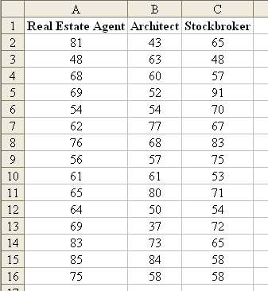{width=45% fig-align="center"}

---

### 实例 2：学生对教师的评价与学习成绩是否相关？

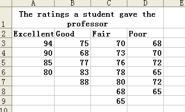{width=55% fig-align="center"}

---

### Excel 单因素方差分析输出结果

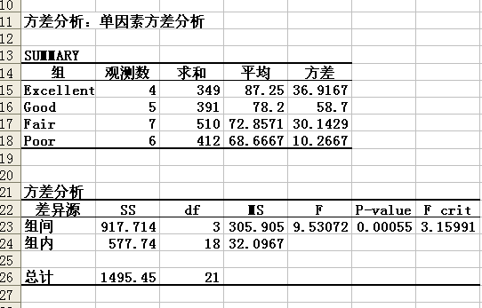{width=75% fig-align="center"}

---

### 实例 3：五个学院薪酬的单因素方差分析（SPSS 输出）

$$
\begin{aligned}
H_0 &: \mu_1 = \mu_2 = \mu_3 = \mu_4 = \mu_5 \\
H_1 &: \mu_1, \mu_2, \mu_3, \mu_4, \mu_5 \text{ 不全相等}
\end{aligned}
$$

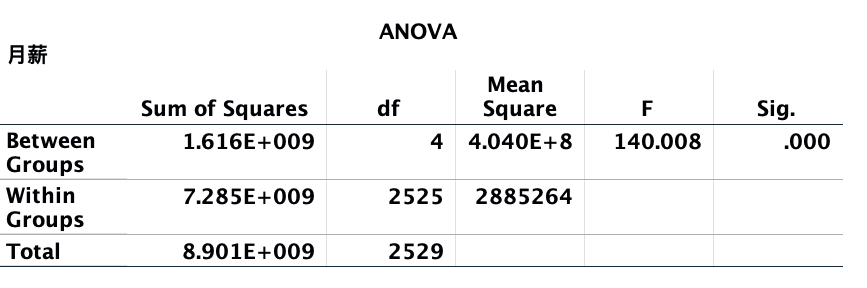{width=85% fig-align="center"}

---

# 10.3 双因素方差分析

---

## 什么是双因素方差分析？

- 涉及**两个定性变量**（行因素 $A$、列因素 $B$）。
- 研究在满足两个定性变量条件的组合下，**定量变量（响应变量）**的观测值差异。
- 包含**两组（或三组）假设检验**：
  - 检验行因素对因变量有无显著影响；
  - 检验列因素对因变量有无显著影响；
  - （可重复试验时）检验行因素与列因素的**交互作用**有无显著影响。

---

## 无重复双因素方差分析

总平方和分解为三部分：

$$SST = SSR + SSC + SSE$$

---

::: {style="font-size: 65%; line-height: 1.2;"}

| 误差来源 | 平方和 ($SS$) | 自由度 ($df$) | 均方 ($MS$) | $F$ 值 | $P$ 值 | $F$ 临界值 |
| :--- | :---: | :---: | :---: | :---: | :---: | :---: |
| **行因素** | $SSR$ | $k - 1$ | $MSR$ | $F_R = \dfrac{MSR}{MSE}$ | $P_R$ | $F_\alpha$ |
| **列因素** | $SSC$ | $r - 1$ | $MSC$ | $F_C = \dfrac{MSC}{MSE}$ | $P_C$ | $F_\alpha$ |
| **误差** | $SSE$ | $(k - 1)(r - 1)$ | $MSE$ | | | |
| **总和** | $SST$ | $kr - 1$ | | | | |
:::

---

### 实例：Two-Way Analysis of Variance

- **因子 A**：对教师的评价
- **因子 B**：每周的自学时数
- **响应变量**：学生的成绩

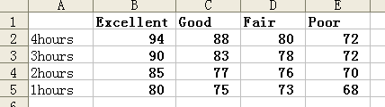{width=65% fig-align="center"}

---

### Excel 双因素方差分析输出结果

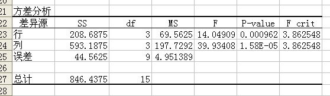{width=80% fig-align="center"}

---

### 实例：分学院分性别月薪的箱线图

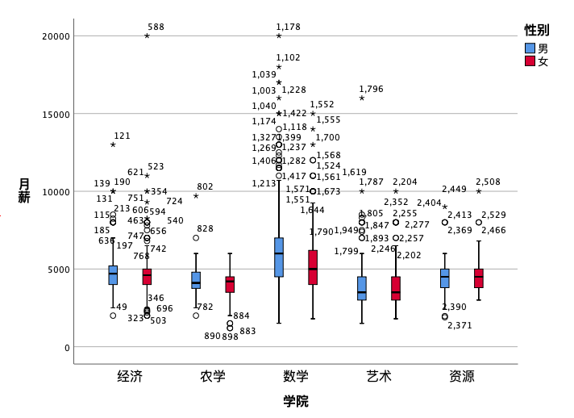{width=70% fig-align="center"}

---

## 可重复双因素方差分析

总平方和分解为四部分：

$$SST = SSR + SSC + SSRC + SSE$$

----

::: {style="font-size: 65%; line-height: 1.2;"}
| 误差来源 | 平方和 ($SS$) | 自由度 ($df$) | 均方 ($MS$) | $F$ 值 | $P$ 值 | $F$ 临界值 |
| :--- | :---: | :---: | :---: | :---: | :---: | :---: |
| **行因素** | $SSR$ | $k - 1$ | $MSR$ | $F_R = \dfrac{MSR}{MSE}$ | $P_R$ | $F_\alpha$ |
| **列因素** | $SSC$ | $r - 1$ | $MSC$ | $F_C = \dfrac{MSC}{MSE}$ | $P_C$ | $F_\alpha$ |
| **交互作用** | $SSRC$ | $(k - 1)(r - 1)$ | $MSRC$ | $F_{RC} = \dfrac{MSRC}{MSE}$ | $P_{RC}$ | $F_\alpha$ |
| **误差** | $SSE$ | $kr(m - 1)$ | $MSE$ | | | |
| **总和** | $SST$ | $n - 1$ | | | | |
::: 

::: {.callout-note}
其中 $m$ 为每个水平组合下重复观测的样本行数，总样本量 $n = krm$。
:::

---

## 第 10 章重点

- **单因素方差分析**
  - 原假设与备择假设
  - 基本假定
  - 方差分析表、$F$检验决策规则
- **双因素方差分析**
  - **无重复**双因素方差分析
  - **可重复**双因素方差分析
