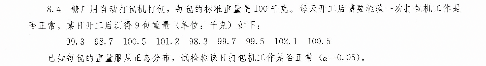
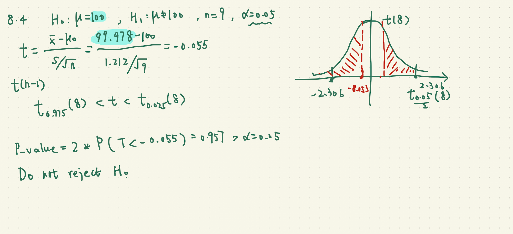
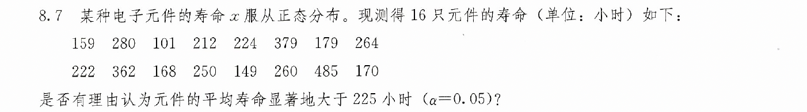
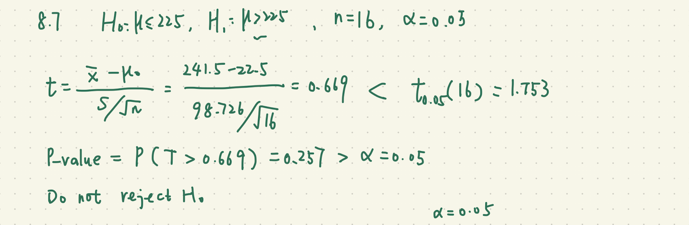
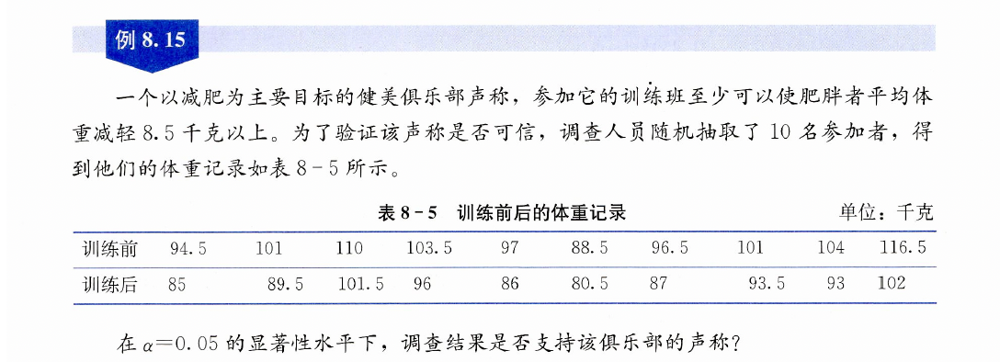
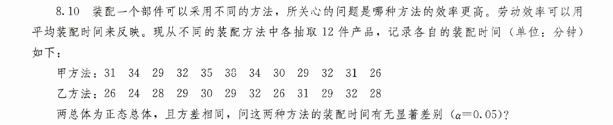

```{r setup, include=FALSE}
knitr::opts_chunk$set(echo = TRUE,comment="")

```

```{r data, include = FALSE}
library(tidyverse)
library(readxl)
par(family  = 'STKaiti')
library(showtext)
showtext_auto()
```


```{r}
#| eval: false
#| include: true
install.packages("ggstatsplot")
library(ggstatsplot)
```


# 总体均值的t检验

## 统计学(第8版)P163 习题8.4



```{r}
#| message: false
#| warning: false
# 1. 加载所需的包
library(ggstatsplot)

# 2. 构建向量并转换为数据框（ggstatsplot 要求输入必须是 data.frame/tibble）
x <- c(99.3, 98.7, 100.5, 101.2, 98.3, 99.7, 99.5, 102.1, 100.5)
df <- data.frame(value = x)

# 3. 使用 gghistostats 进行单样本检验与绘图
p <- gghistostats(
  data = df,
  x = value,                     # 待检验的连续变量列名
  test.value = 100,              # 原假设设定的均值 (mu_0 = 100)
  test.value.line = TRUE,        # 在图中绘制参考均值虚线
  test.value.color = "red",       # 参考均值线的颜色
  centrality.line.args = list(color = "blue", linetype = "dashed"), # 样本均值线
  bin.args = list(color = "black", fill = "cyan", alpha = 0.7),
  type = "parametric",           # 参数检验（单样本 Student's t 检验）
  normal.curve = TRUE,           # 叠加理论正态分布曲线
  binwidth = 0.5,                # 调整直方图箱宽（适合小样本）
  title = "单样本 t 检验：总体均值检验",
  xlab = "观测值 (x)",
  ylab = "频数"
)

# 4. 显示图表
print(p)

```




# 总体均值的t检验

## 统计学(第8版)P163 习题8.7


```{r}
#| message: false
#| warning: false
# 1. 加载所需的包
library(ggstatsplot)
library(ggplot2)

# 2. 构建向量并转换为数据框（ggstatsplot 要求输入必须是 data.frame/tibble）
x <- c(159, 280, 101, 212, 224, 379, 179, 264,
       222, 362, 168, 250, 149, 260, 485, 170)
df <- data.frame(value = x)

# 3. 使用 gghistostats 进行单样本检验与绘图
p <- gghistostats(
  data = df,
  x = value,                     # 待检验的连续变量列名
  test.value = 225,              # 原假设设定的均值 (mu_0 = 225)
  alternative = "greater",        # 单尾检验，检验均值是否大于225
  test.value.line = TRUE,        # 在图中绘制参考均值虚线
  test.value.color = "red",       # 参考均值线的颜色
  centrality.line.args = list(color = "blue", linetype = "dashed"), # 样本均值线
  bin.args = list(color = "black", fill = "cyan", alpha = 0.7),
  type = "parametric",           # 参数检验（单样本 Student's t 检验）
  normal.curve = TRUE,           # 叠加理论正态分布曲线
  binwidth = 100,                # 调整直方图箱宽
  title = "单样本 t 检验：总体均值检验",
  xlab = "观测值 (x)",
  ylab = "频数"
)

# 4. 显示图表
print(p)

```




# 两个配对总体均值的t检验

## 统计学(第8版)P157 例题8.15



```{r}
before <- c(94.5, 101, 110, 103.5, 97, 
            88.5, 96.5, 101, 104, 116.5)
after <- c(85, 89.5, 101.5, 96, 86, 
           80.5, 87, 93.5, 93, 102)

# 配对检验长数据结构
df_paired <- data.frame(
  id = factor(rep(1:10, 2)),                                      # 必须包含被试 ID
  stage = factor(rep(c("训练前", "训练后"), each = 10)),
  weight = c(before, after)
)

# 真正的配对检验函数
ggwithinstats(
  data = df_paired,
  x = stage,
  y = weight,
  type = "parametric"   # 配对 t 检验 (Paired t-test),差值的均值是否等于0
)
```


```{r}
library(ggstatsplot)
library(tidyr)

# 将 after 平移 8.5，使原检验转化为针对 0 的配对检验
df_adjusted <- data.frame(
  id = factor(1:10),
  before = before,
  after_plus_8.5 = after + 8.5
)

df_long <- pivot_longer(
  df_adjusted,
  cols = c("before", "after_plus_8.5"),
  names_to = "stage",
  values_to = "weight"
)

ggwithinstats(
  data = df_long,
  x = stage,
  y = weight,
  type = "parametric",
  alternative = "less",
  title = "配对 t 检验（检验差值是否显著大于 8.5）"
)
```


```{r}
before <- c(94.5, 101, 110, 103.5, 97, 
            88.5, 96.5, 101, 104, 116.5)
after <- c(85, 89.5, 101.5, 96, 86, 
           80.5, 87, 93.5, 93, 102)

t.test(before, after, alternative = "greater", 
       mu = 8.5, paired = TRUE)

```


# 两个独立总体均值的t检验, 两个独立总体方差的F检验

## 统计学(第8版)P164 习题8.10



```{r}
library(ggstatsplot)

# 1. 录入数据
method_A <- c(31, 34, 29, 32, 35, 38, 34, 30, 29, 32, 31, 26)
method_B <- c(26, 24, 28, 29, 30, 29, 32, 26, 31, 29, 32, 28)

# 2. 构建长数据框 (Long format)
df_assembly <- data.frame(
  time = c(method_A, method_B),
  method = factor(rep(c("甲方法", "乙方法"), each = 12))
)

# 3. 使用 ggbetweenstats 执行独立两样本 t 检验与绘图
p <- ggbetweenstats(
  data = df_assembly,
  x = method,                   # 分组变量
  y = time,                     # 连续数值变量（装配时间）
  type = "parametric",          # 参数检验 (Student's t-test)
  var.equal = TRUE,             # 题设已知方差相同，等方差 t 检验
  pairwise.comparisons = TRUE,  # 显示组间两两比较
  title = "两种装配方法的平均装配时间差异检验",
  xlab = "装配方法",
  ylab = "装配时间 (分钟)"
)

# 4. 打印图表
print(p)
```


1. 两种方法的装配时长的方差是否相等？显著性水平为0.05.

```{r}
甲 <- c(31, 34, 29, 32, 35, 38, 
       34, 30, 29, 32, 31, 26)
乙 <- c(26, 24, 28, 29, 30, 29, 
       32, 26, 31, 29, 32, 28)

var.test(甲,乙)

```

P值等于0.4，在0.05的显著性水平下，不拒绝“方差相等的原假设”

2. 能否认为甲方法装配时长的均值显著高于乙方法装配时长的均值？显著性水平为0.05.

方差相等的t检验

```{r}
t.test(甲,乙, alternative = "greater",
       var.equal = TRUE)

```

P值等于0.007，在0.05的显著性水平下，拒绝“miu_甲<=miu_乙”的原假设。

认为甲方法装配时长的均值显著高于乙方法装配时长的均值


