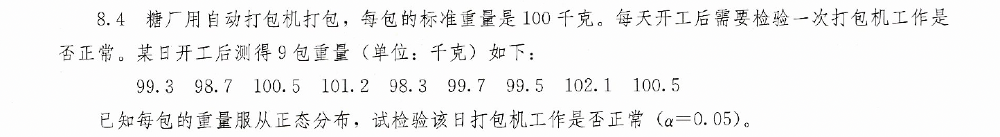
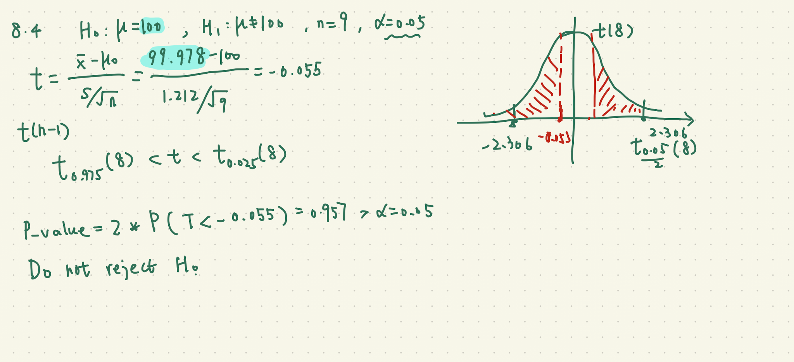
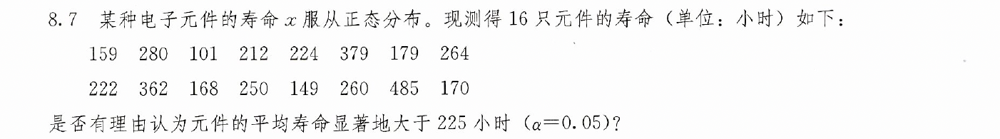
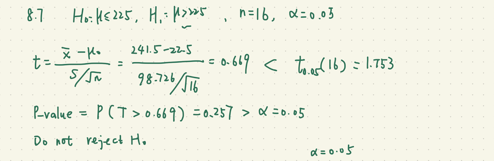
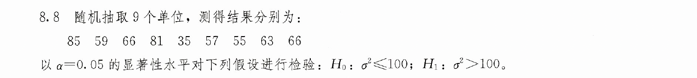
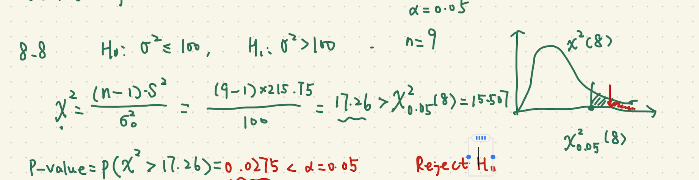
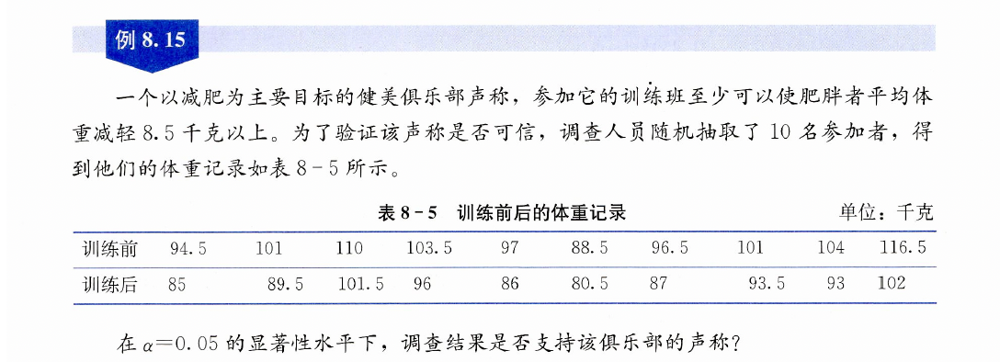
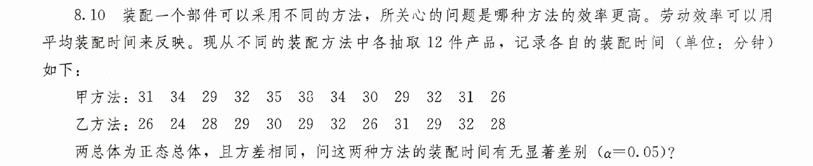

```{r setup, include=FALSE}
knitr::opts_chunk$set(echo = TRUE,comment="")
```

```{r data, include = FALSE}
library(tidyverse)
library(readxl)
```


# 总体均值的t检验

## 统计学(第8版)P163 习题8.4



```{r}
x <- c(99.3,98.7,100.5,101.2,98.3,99.7,99.5,102.1,100.5)
t.test(x, mu = 100)

```




# 总体均值的t检验

## 统计学(第8版)P163 习题8.7


```{r}
x <- c(159, 280, 101, 212, 224, 379, 179, 264,
       222, 362, 168, 250, 149, 260, 485, 170)
t.test(x, mu = 225, alternative = "greater")
```


# 总体方差的卡方检验

## 统计学(第8版)P163 习题8.8

```{r message=FALSE}
library(EnvStats)
x <- c(85, 59, 66, 81, 35, 57, 55, 63, 66)
varTest(x, alternative = "greater", 
        sigma.squared = 100)

```



# 两个配对总体均值的t检验

## 统计学(第8版)P157 例题8.15

```{r}
before <- c(94.5, 101, 110, 103.5, 97, 
            88.5, 96.5, 101, 104, 116.5)
after <- c(85, 89.5, 101.5, 96, 86, 
           80.5, 87, 93.5, 93, 102)

t.test(before, after, alternative = "greater", 
       mu = 8.5, paired = TRUE)

```


# 两个独立总体均值的t检验, 两个独立总体方差的F检验

## 统计学(第8版)P164 习题8.10


1. 两种方法的装配时长的方差是否相等？显著性水平为0.05.


```{r}
甲 <- c(31, 34, 29, 32, 35, 38, 
       34, 30, 29, 32, 31, 26)
乙 <- c(26, 24, 28, 29, 30, 29, 
       32, 26, 31, 29, 32, 28)

var.test(甲,乙)

```

P值等于0.4，在0.05的显著性水平下，不拒绝“方差相等的原假设”

2. 能否认为甲方法装配时长的均值显著高于乙方法装配时长的均值？显著性水平为0.05.

方差相等的t检验

```{r}
t.test(甲,乙, alternative = "greater",
       var.equal = TRUE)

```

P值等于0.007，在0.05的显著性水平下，拒绝“miu_甲<=miu_乙”的原假设。

认为甲方法装配时长的均值显著高于乙方法装配时长的均值


